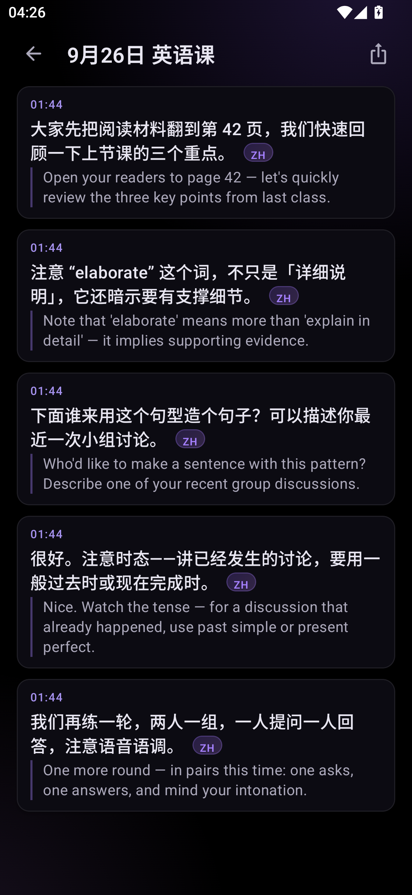
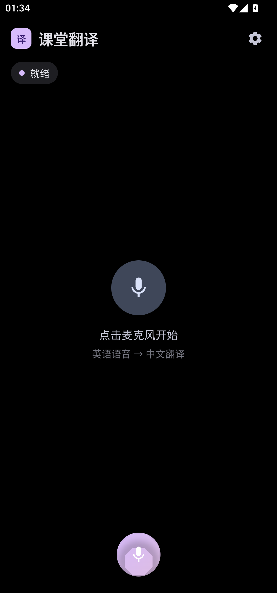
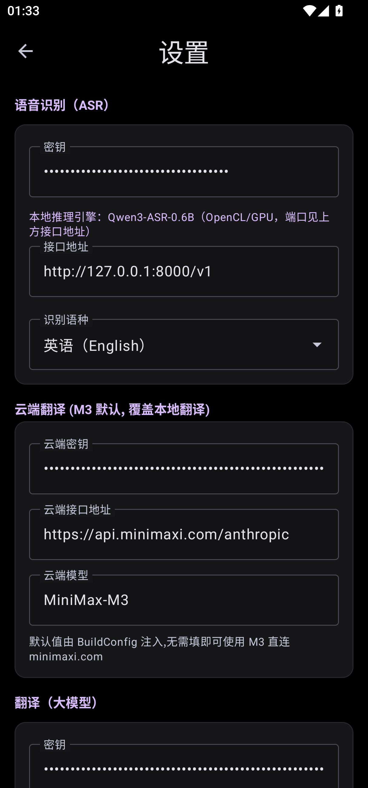
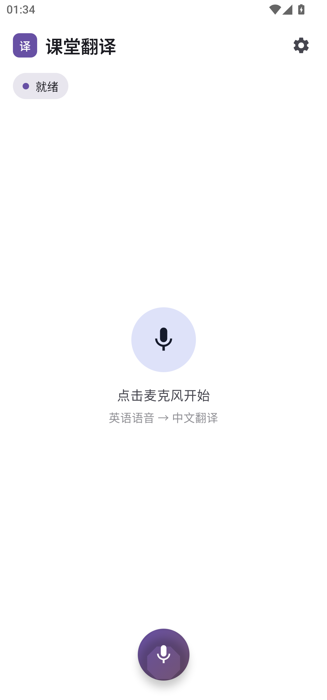

# Classroom Translator · 课堂翻译

> 实时课堂翻译 Android 应用：多引擎语音识别（ASR）+ 大模型翻译，双语卡片即时呈现。
> **Real-time classroom translation app with multi-engine ASR and LLM translation, delivering instant dual-language cards.**

<p>
  
  
  
</p>

<p align="center">
  
</p>

## 📖 项目简介

面向**跨国课堂场景**（如马来西亚中英混讲课堂）的实时翻译工具：持续采集课堂语音，经 ASR 流式识别后调用大模型翻译，以「原文 + 译文」双语卡片滚动呈现；课后可对整节课录音做批量转录，生成带时间戳的双语字幕。

针对"课堂语音中英混杂、本地隐私敏感、网络条件不稳定"三大痛点，设计了**三引擎可切换 ASR 架构**：云端流式（低延迟）/ 本地部署（离线隐私）/ 分片回退（弱网兜底）。

> In short: an Android app that listens to a lecture, recognizes speech (English / Chinese / mixed), translates it, and shows bilingual cards in real time. Supports cloud streaming ASR, a fully local ASR server (privacy-friendly), and whole-session audio transcription with timestamped subtitles.

## ✨ 核心功能

| 功能 | 说明 |
|---|---|
| 🎙 **实时双语卡片** | 语音 → 流式 ASR → LLM 翻译 → 卡片即时上屏，句子级延迟约 2–3 秒 |
| 🔀 **三 ASR 引擎可切换** | ① DashScope Fun-ASR Realtime（云端流式）② 本地 Qwen3-ASR（离线隐私）③ MIMO（分片回退），设置页一键切换 |
| 📼 **整课转录** | 上传整节课录音 → 逐段转录 + 翻译 → 带时间戳的双语字幕，支持回看 |
| 🌏 **混讲识别** | `auto` 语种检测，支持中英混讲课堂（马来课堂场景验证） |
| 🎨 **双主题** | OLED 纯黑深色 + 浅色主题，按设计稿像素级还原 |
| 🔒 **隐私可选** | 本地 ASR/翻译模式全链路不出内网，适合隐私敏感场景 |

## 📱 界面预览

| 主界面 | 翻译详情（双语卡片） | 设置 | 整课转录 | 浅色主题 |
|---|---|---|---|---|
|  |  |  |  |  |

## 🏗 技术架构

```
 ┌──────────┐   PCM 16k   ┌───────────────┐   OpenAI 兼容    ┌─────────────┐
 │ 麦克风/   │ ──────────► │  ASR 引擎层    │ ──────────────► │  LLM 翻译层  │
 │ 系统内录  │             │  (可切换 3 种) │                 │  (流式输出)  │
 └──────────┘             └───────────────┘                 └──────┬──────┘
                                                                     │
                                                            ┌────────▼────────┐
                                                            │  Compose UI      │
                                                            │  双语卡片 / 详情  │
                                                            └─────────────────┘
```

- **ASR 引擎层**：抽象 `AsrEngine` 接口 + 多种实现——
  - `DashScopeAsrStream`：WebSocket 双向流式（云端，实时出句）
  - `LocalVllmAsrStream`：每 2 秒发送累积音频至本地 vLLM 服务（OpenAI 兼容接口），整句返回
  - `OfflineAsrEngine`（sherpa-onnx）+ `PlaybackCaptureRecorder`（系统内录）扩展模块
- **翻译层**：OpenAI 兼容 API，支持流式输出；内置「剥离思考过程」等后处理
- **数据层**：会话/段落持久化（DataStore），历史页按日期分组，详情页支持播放定位
- **UI 层**：Jetpack Compose + Material 3，设计 token 统一管理（`ui/theme/Color.kt`）

## 🛠 技术栈

- **语言/框架**：Kotlin 2.0.21 · Jetpack Compose · Material 3 · Coroutines/Flow
- **构建**：Gradle 8.10.2 · AGP 8.7.3 · JDK 17 · 阿里云 Maven 镜像
- **音频**：AudioRecord / MediaProjection 内录 · PCM 处理 · VAD 分句
- **网络**：OkHttp WebSocket（流式）· OpenAI 兼容 HTTP API
- **本地推理**：Qwen3-ASR 系列模型（WSL2 + vLLM 部署，OpenAI 兼容服务）

## 🚀 快速开始

### 构建

```bash
# 需要 JDK 17
./gradlew assembleDebug
# 产物: app/build/outputs/apk/debug/app-debug.apk
```

> **依赖说明**：`app/libs/sherpa-onnx-*.aar`（离线 ASR）与 `app/src/main/jniLibs/` 下的 `libllamasrv.so`（本地推理服务端）为本地二进制依赖，未入库。仅使用云端/本地 vLLM 模式时无需它们；离线模式请从 [sherpa-onnx](https://github.com/k2-fsa/sherpa-onnx) 官方获取对应版本。

### 配置（应用内设置页）

| 配置项 | 示例 | 说明 |
|---|---|---|
| ASR 地址 | `https://dashscope.aliyuncs.com/...` 或 `http://<电脑IP>:8000/v1` | 云端或本地 vLLM |
| ASR Key | 你的 API Key | 云端模式需填 |
| 翻译地址 | `http://<电脑IP>:8002/v1` 等 | OpenAI 兼容接口 |
| 识别语种 | `auto` | 混讲场景保持 auto |

密钥可通过 `local.properties`（不入库）或设置页管理：

```properties
# local.properties 示例（请勿提交真实密钥）
DASHSCOPE_API_KEY=your_key_here
```

### 本地 ASR 服务（可选）

```bash
# WSL2 中启动 vLLM ASR 服务（Qwen3-ASR）
vllm serve /path/to/Qwen3-ASR-1.7B --port 8000
```

模型评测与部署细节见配套项目 *asr-evaluation*（马来西亚口音英语场景，多模型横向对比）。

## 📂 项目结构

```
app/src/main/java/com/classroom/translator/
├── MainActivity.kt              # 入口 + 导航
├── audio/                       # ASR 引擎（DashScope/本地vLLM/离线）、录音、PCM 转换
├── api/                         # OpenAI 兼容 API 客户端
├── data/                        # 会话/设置持久化（SessionManager, SettingsRepository）
├── local/                       # 本机 llama-server 管理（jniLibs 部署）
└── ui/                          # Compose 界面
    ├── screens/                 # Main / History / Settings / WholeSession
    └── theme/                   # 设计 token（深/浅双主题）
```

## 📐 工程实践亮点

- **设计到代码的像素级还原**：基于高保真设计稿重建四屏界面，自研对比工具（锚点对齐 + 逐格色差），主界面平均色差 16.4/765（肉眼不可分辨区间），验证方法与得分均可复现（见 `设计稿实现说明.md`）
- **多模型实测对比**：在 1453 句全量测试集上横向评测多个 ASR 模型的混讲识别正确率，择优接入（Qwen3-ASR 纯英语 93.5% · Polyglot-Lion 混讲 86.2%）
- **75+ 次迭代**：v1.0 → v1.4.2 持续迭代（完整 git 历史），含真机测试报告、架构文档与设计说明

## 📄 文档索引

| 文档 | 内容 |
|---|---|
| `APP_INTEGRATION.md` | App ↔ 本地服务集成方案（端口、可达性、风险） |
| `设计稿实现说明.md` | 像素级还原的验证方法与色差评分 |
| `ONDEVICE_PLAN.md` / `SELF_CONTAINED_ARCH.md` | 端侧推理与自包含架构规划 |
| `TEST_REPORT_20260911.md` | 真机测试报告 |
| `research/` | ASR 稳定性、内存、NPU 等专项调研 |
